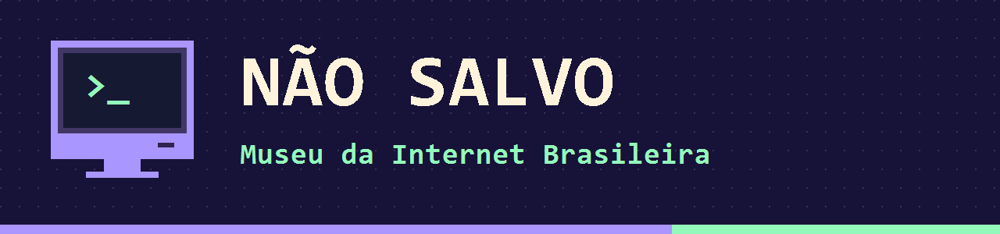

E se desse pra escolher um ano e passear pela internet brasileira daquela época? A ideia que o Cid trouxe na live é construir essa cápsula do tempo junto com a comunidade. Tem espaço pros blogs que a gente visitava todo dia, pros vídeos que passavam de amigo em amigo e pras comunidades do Orkut que a gente ainda lembra pelo nome.

> **🚧 Projeto em planejamento**  
> A primeira live foi o ponto de partida. O escopo continua aberto a ideias da comunidade, e as tecnologias do app ainda serão definidas.

## 📼 Por dentro do acervo

Cada item teria uma ficha contando **o que era, quando circulou e por que marcou época**. Alguém lembra do vídeo, outra pessoa reconhece o ano e uma terceira encontra uma cópia arquivada quando o link original já sumiu. É assim que a comunidade pode reconstruir cada história.

| Ideia da primeira live | O que você poderia fazer |
| :--- | :--- |
| 🗓️ **Viagem por ano** | Escolher um ano e descobrir o que bombava naquela época. |
| 👤 **Perfil da comunidade** | Criar uma conta para participar da construção do museu. |
| 📥 **Envio de itens** | Sugerir um meme, vídeo, blog ou comunidade e compartilhar o que você sabe sobre ele. |

🐈 Também entraram na conversa os avatares de gatinho e, mais adiante, um álbum de figurinhas com lendas da internet brasileira.

## 💬 Como participar

- **Planejamento e desenvolvimento** · Por enquanto, a equipe se organiza no canal `#nao-salvo-2` do Discord para discutir o app e combinar os próximos passos.
- **Brainstorm da comunidade** · As ideias e propostas serão reunidas na branch `brainstorm` do repositório. Pensou numa forma legal de explorar o acervo? Esse será o lugar pra compartilhar.

## 🧭 Quem cuida do projeto

| Responsabilidade | Quem assume |
| :--- | :--- |
| Decisão final sobre os rumos do projeto | **Cid Cidoso** |
| Moderação central | **Seppzão** |
